<div align="center">

# Waybill Platform
### Nền Tảng Điều Phối & Quản Trị Vận Đơn Bưu Chính Toàn Trình
*Enterprise Event-Driven Microservices Architecture*

<br/>

[](https://waybill-express.japaneast.cloudapp.azure.com)
[](docs/12-kubernetes-orchestration-and-deployment.md)
[](https://github.com)
[](LICENSE)

<br/>

<p align="center">
  <code>14 Microservices</code> &nbsp;•&nbsp; 
  <code>5 Siêu Hub Toàn Quốc</code> &nbsp;•&nbsp; 
  <code>13 Trạng Thái Bưu Gửi</code> &nbsp;•&nbsp; 
  <code>&lt; 1.5s GenAI Inference</code> &nbsp;•&nbsp; 
  <code>$0 Cloud Cost</code>
</p>

</div>

---

> [!IMPORTANT]
> ### LIVE PRODUCTION CLOUD DEMO (HTTPS SSL)
> Hệ thống hiện đang được triển khai thực tế trên hạ tầng đám mây **Microsoft Azure (Region Japan East)** vận hành bởi cụm **Kubernetes (K3s)** với chứng chỉ bảo mật SSL/TLS tự động cấp bởi **Let's Encrypt**:
> 
> * **Đường dẫn truy cập trực tiếp:** **[https://waybill-express.japaneast.cloudapp.azure.com](https://waybill-express.japaneast.cloudapp.azure.com)**
> * **Hạ tầng phục vụ:** Nén toàn bộ 14 Microservices, Kafka KRaft, Redis, SQL Server, MinIO, RabbitMQ và LLM Qwen 2.5 trên 1 VM Azure duy nhất với chi phí **$0.00** nhờ kỹ thuật tinh giản JVM SerialGC.

---

## 1. Giới Thiệu Tổng Quan & Ma Trận Công Nghệ (Tech Stack Matrix)

**Waybill Platform** là nền tảng Microservices chuẩn Enterprise mô phỏng chuỗi cung ứng chuyển phát bưu chính toàn trình: từ tiếp nhận bưu phẩm quầy B2B, quản lý chuyến xe trục liên tỉnh (Trips Management), phân luồng tại 5 Siêu Hub trọng điểm toàn quốc, cho đến điều phối bưu tá phát hàng chặng cuối và quyết toán dòng tiền thu hộ COD 3 pha.

### Bảng Ma Trận Công Nghệ Cốt Lõi

| Phân Tầng Kiến Trúc | Hệ Sinh Thái Công Nghệ & Badges | Vai Trò & Trọng Tâm Kỹ Thuật |
| :--- | :--- | :--- |
| **Backend & Client Portal** | [](https://www.oracle.com/java/) [](https://spring.io/projects/spring-boot)<br/>[](https://spring.io/projects/spring-cloud) [](https://vuejs.org/) | • Kiến trúc 14 Microservices độc lập quản lý đa module qua Maven Parent POM.<br/>• Spring Cloud Gateway HA cân bằng tải, Rate Limiting và Eureka Service Registry 2 chiều.<br/>• Frontend Vue 3 SPA B2B, tối ưu RAM với Component Caching `<keep-alive>` và bản đồ Leaflet GIS. |
| **Dữ Liệu & Event-Driven** | [](https://kafka.apache.org/) [](https://redis.io/)<br/>[](https://www.microsoft.com/sql-server) [](https://www.rabbitmq.com/) | • Cụm 3 Broker Kafka KRaft bảo đảm Exactly-Once Semantics, Zero-Copy và Idempotent Producer.<br/>• Phân tách Đọc/Ghi dữ liệu (Database Read-Write Splitting) với `AbstractRoutingDataSource`.<br/>• Redis Distributed Lock (`SETNX`) chống race condition và Token Blacklist (< 0.5ms).<br/>• Quản lý bộ đếm ngược SLA bưu phẩm 120s bằng RabbitMQ Message TTL và Dead Letter Queue. |
| **Trí Tuệ Nhân Tạo & Storage** | [](https://spring.io/projects/spring-ai) [](https://min.io/)<br/>[](https://core.telegram.org/bots) [](https://vietqr.net/) | • Trợ lý GenAI On-Premise (Ollama `qwen2.5:3b`), CPU inference < 1.5s với Autonomous Tool Calling.<br/>• Lưu trữ chứng từ MinIO Private S3 Bucket, kiểm tra Magic-byte và Pre-signed URLs 10 phút.<br/>• Điều phối bưu tá 2 chiều qua Telegram Bot (Long-Polling không yêu cầu mở cổng Inbound).<br/>• Cổng VietQR NAPAS 247 động, xác thực chữ ký Webhook và đối soát tự động qua Kafka. |
| **Cloud Hạ Tầng & GitOps** | [](https://azure.microsoft.com/) [](https://k3s.io/)<br/>[](https://argoproj.github.io/cd/) [](https://github.com/features/actions)<br/>[](https://grafana.com/) | • Máy ảo Azure Region Japan East ($0 chi phí), tinh giản JVM SerialGC nén 14 services dưới 4.5 GB RAM.<br/>• Cụm K3s Kubernetes gọn nhẹ tích hợp Ingress HTTPS Let's Encrypt tự động.<br/>• Quy trình GitOps tự động hóa triển khai qua ArgoCD kết hợp GitHub Actions CI đa luồng.<br/>• Giám sát thời gian thực với Prometheus TSDB và 3 bộ Dashboard Grafana chuyên nghiệp. |

---

## 2. Trụ Cột Nghiệp Vụ & Kiến Trúc Cốt Lõi (Core Pillars)

```
                            MẠNG LƯỚI LOGISTICS TOÀN TRÌNH
 [Bưu cục gửi] ──> [Siêu Hub gửi] ──(Xe trục)──> [Siêu Hub nhận] ──> [Bưu cục phát] ──> [Bưu tá]
       │                 │                             │                  │               │
  Tạo vận đơn      Quét mã gom tải              Dỡ hàng phân luồng    Phân tuyến phát    Báo phát/COD
```

1. **Mô Hình Mạng Lưới 5 Siêu Hub Toàn Quốc (Hub-and-Spoke Network):**
   * Vận hành mạng lưới phân luồng bưu chính đa chặng kết nối 5 Hub trọng điểm: Hà Nội (`HUB-HN-01`), Hải Phòng (`HUB-HP-01`), Đà Nẵng (`HUB-DN-01`), TP.HCM (`HUB-HCM-01`) và Cần Thơ (`HUB-CT-01`).
   * Kiểm soát tải trọng chuyến xe liên tỉnh theo thời gian thực (ngưỡng 80% - 100%), niêm phong mã Seal và bảo vệ đa luồng bằng Redis Distributed Lock (`SETNX`).
   * *Xem thêm:* [Cẩm nang 04 - Nghiệp Vụ Logistics & Hub-and-Spoke](docs/04-logistics-domain-and-rbac-station-context.md) và [Cẩm nang 05 - Redis Distributed Lock](docs/05-redis-caching-and-distributed-patterns.md).

2. **Máy Trạng Thái Bưu Gửi 13 Bước & Saga Hủy Đơn Bù Trừ:**
   * Chu trình trạng thái chặt chẽ: `CREATED` $\rightarrow$ `PENDING_ROUTING` $\rightarrow$ `ROUTE_ASSIGNED` $\rightarrow$ `PICKED_UP` $\rightarrow$ `IN_TRANSIT` $\rightarrow$ `ARRIVED_DEST_HUB` $\rightarrow$ `OUT_FOR_DELIVERY` $\rightarrow$ `DELIVERED`.
   * Luồng chuyển hoàn tự động khi phát thất bại quá 3 lần: `RETURNING` $\rightarrow$ `OUT_FOR_RETURN` $\rightarrow$ `RETURNED`, kết hợp cổng quyết định xử lý 24h của khách hàng (giao lại / đổi địa chỉ / hoàn gấp).
   * Hủy đơn an toàn liên dịch vụ qua Transactional Outbox Pattern, Saga bù trừ, Redis Tombstone và giải phóng tải trọng xe.
   * *Xem thêm:* [Cẩm nang 04 - Máy Trạng Thái Bưu Gửi](docs/04-logistics-domain-and-rbac-station-context.md), [Cẩm nang 19 - Transactional Outbox & Saga](docs/19-transactional-outbox-and-saga-compensation.md), [Cẩm nang 23 - Luồng Chuyển Hoàn](docs/23-customer-return-flow.md).

3. **Kiến Trúc Hướng Sự Kiện (Event-Driven KRaft) & Database Read-Write Splitting:**
   * Cụm Apache Kafka KRaft HA (3 Brokers) không phụ thuộc Zookeeper, bảo đảm Exactly-Once Semantics, Idempotent Producer và truyền dữ liệu Zero-Copy.
   * Phân tách Đọc/Ghi dữ liệu (Database Read-Write Splitting) độc lập qua Spring `AbstractRoutingDataSource`, định tuyến Primary (Port 1433) và Read-Replica (Port 2433).
   * Polyglot Messaging: Kết hợp RabbitMQ Message TTL (120s) và Dead Letter Exchange (DLX) quản lý bộ đếm ngược SLA bưu gửi.
   * *Xem thêm:* [Cẩm nang 02 - Database Read-Write Splitting](docs/02-database-read-write-splitting-boilerplate.md), [Cẩm nang 03 - Kafka KRaft Cluster](docs/03-kafka-kraft-cluster-and-event-streaming.md), [Cẩm nang 15 - RabbitMQ SLA TTL](docs/15-rabbitmq-priority-queue-and-sla-dead-letter-patterns.md).

4. **Trợ Lý Trí Tuệ Nhân Tạo GenAI On-Premise (Spring AI Tool Calling):**
   * Tích hợp LLM nội bộ qua Ollama với mô hình `qwen2.5:3b`, bảo mật dữ liệu khách hàng nội bộ và tối ưu suy luận CPU (< 1.5s/câu trả lời) không cần GPU.
   * Cơ chế Autonomous Function Calling: AI tự động phân tích ý định và gọi Tool tra cứu hành trình bưu phẩm hoặc tính cước trực tiếp theo thời gian thực.
   * Phản hồi dạng dòng Server-Sent Events (SSE) và quản lý đính kèm chứng từ qua MinIO Private S3 Storage với Pre-signed URLs có hạn 10 phút.
   * *Xem thêm:* [Cẩm nang 14 - Trợ Lý Ảo Spring AI](docs/14-spring-ai-agent-and-support-ticketing.md) và [Cẩm nang 16 - MinIO S3 Boilerplate](docs/16-minio-object-storage-and-s3-boilerplate.md).

5. **Bảo Mật Phân Tầng, Ngữ Cảnh Trạm & Đối Soát COD 3 Pha:**
   * Xác thực phi trạng thái (Stateless JWT) tại Gateway, thu hồi phiên tức thì qua Redis Blacklist (< 0.5ms) và Session/Role Versioning.
   * Ràng buộc ngữ cảnh trạm (Station Context RBAC) qua header `X-User-Location-Code` ngăn nhân viên can thiệp bưu phẩm ngoài địa bàn phân công.
   * Chu trình quyết toán tiền thu hộ COD 3 pha: `UNSETTLED` $\rightarrow$ `PENDING_SETTLEMENT` $\rightarrow$ `SETTLED` bảo toàn chứng từ tài chính.
   * Tích hợp Cổng thanh toán động VietQR NAPAS 247, xác thực chữ ký Webhook và tự động gạch nợ tức thời qua Kafka.
   * *Xem thêm:* [Cẩm nang 06 - JWT & RBAC](docs/06-microservices-security-jwt-and-rbac.md), [Cẩm nang 09 - Quyết Toán COD](docs/09-cod-settlement-and-financial-reconciliation.md), [Cẩm nang 17 - Cổng VietQR](docs/17-vietqr-payment-gateway-and-realtime-reconciliation.md), [Tài Liệu Bảo Mật Toàn Trình](docs/security-rollout.md).

6. **Điều Phối Bưu Tá Tác Nghiệp & Quản Trị Đội Xe Vận Tải:**
   * Tương tác 2 chiều với bưu tá qua Telegram Bot (Long-Polling): nhận đơn đi phát, báo phát thành công, hẹn lại và đối soát COD trực tiếp mà không cần mở cổng IP tĩnh.
   * Thông báo thời gian thực tới Web Portal qua WebSocket STOMP Broker (< 50ms) thay thế hoàn toàn cơ chế Polling.
   * Động cơ ước tính ETA động theo Cut-off bưu cục, giám sát phân loại 3 đội xe (`/fleet`) và dự báo sản lượng bưu gửi.
   * *Xem thêm:* [Cẩm nang 07 - Telegram Bot & WebSocket](docs/07-telegram-bot-and-realtime-notifications.md), [Cẩm nang 20 - Dynamic ETA Engine](docs/20-dynamic-eta-engine-and-delivery-forecast.md), [Cẩm nang 21 - Fleet Management](docs/21-fleet-vehicle-management-and-shipper-bot-actions.md).

---

## 3. Sơ Đồ Kiến Trúc Hệ Thống (System Architecture)

```mermaid
flowchart TD
    subgraph Clients["Tầng Trải Nghiệm Khách Hàng & Vận Hành"]
        Web["Web Portal (Vue 3 SPA + Tailwind + Leaflet)"]
        Tele["Telegram Bot (Bưu Tá Tác Nghiệp)"]
        QR["Khách Hàng Quét Mã VietQR"]
    end

    subgraph Edge["Tầng Cổng Vào & Điều Hướng (Edge Layer)"]
        Ingress["Azure Traefik / Nginx Ingress Controller (SSL/TLS)"]
        Gateway["Spring Cloud API Gateway HA (Port 8080 / 8088)\nJWT Stateless • RBAC • Redis Rate Limiter"]
    end

    subgraph CoreServices["Tầng 14 Microservices Nghiệp Vụ Bưu Chính (Spring Boot 4.1.1)"]
        Registry["Eureka Registry Peer-to-Peer (Port 8761 / 8762)"]
        Auth["Auth Service (Port 8087)"]
        Customer["Customer Service (Port 8081)"]
        Shipment["Shipment & Pricing (Port 8082)"]
        Routing["Routing & Trips (Port 8083)"]
        Tracking["Tracking & State Machine (Port 8084 / 8094)"]
        Notification["Notification Service (Port 8085)"]
        Audit["Audit Service (Port 8086)"]
        Shipper["Shipper Service (Port 8089)"]
        Report["Report & COD Service (Port 8091)"]
        Rating["Rating & KPI Service (Port 8092)"]
        Support["Support & Spring AI (Port 8093)"]
        Payment["Payment Service VietQR (Port 8095)"]
    end

    subgraph DataBroker["Tầng Dữ Liệu, Event Streaming & Hạ Tầng Phụ Trợ"]
        Kafka["Apache Kafka KRaft HA Cluster (3 Brokers)\nEvent Streaming • CQRS Sync"]
        SQLServer["SQL Server 2022 HA\nPrimary (Port 1433) • Replica (Port 2433)"]
        Redis["Redis 7.x In-Memory\nDistributed Lock • Token Blacklist • Caching"]
        Rabbit["RabbitMQ Message Broker\nSLA TTL 120s • Dead Letter Queue"]
        MinIO["MinIO Object Storage (S3 API)\nPrivate Bucket • Pre-signed URLs"]
        Ollama["Ollama On-Premise LLM\nModel qwen2.5:3b (CPU Inference)"]
    end

    Web --> Ingress
    Tele --> Gateway
    QR --> Gateway
    Ingress --> Gateway
    Gateway --> CoreServices
    CoreServices -.-> Registry
    CoreServices --> Kafka
    CoreServices --> SQLServer
    CoreServices --> Redis
    CoreServices --> Rabbit
    Support --> MinIO
    Support --> Ollama
```



### Thông Số Triển Khai Cloud Tối Ưu (Azure K3s Cost Optimization)

| Thành Phần / Tham Số | Cấu Hình Triển Khai Thực Tế | Kỹ Thuật Tối Ưu Nổi Bật |
| :--- | :--- | :--- |
| **Hạ Tầng Điện Toán** | Azure `Standard_E2as_v4` | 2 vCPU, 16 GiB RAM, ổ đĩa 30 GB SSD Premium tại Region Japan East (Độ trễ về VN ~40ms). |
| **K3s Kubernetes** | Single-Node Cluster | K3s lược bỏ etcd và các driver đám mây dư thừa, giảm 80% RAM nền so với K8s tiêu chuẩn. |
| **JVM Memory Tuning** | `-Xms64m -Xmx200m -XX:+UseSerialGC` | Ép giới hạn heap tối đa 200MB/service; SerialGC loại bỏ hoàn toàn overhead đa luồng thu gom rác trên CPU 2 lõi, nén 14 microservices chạy mượt mà dưới **~4.5 GB RAM**. |
| **Trí Tuệ Nhân Tạo AI** | Ollama `qwen2.5:3b` (~1.9 GB) | Mô hình 3B đa ngôn ngữ tối ưu cho CPU inference, phản hồi < 1.5s mà không cần GPU đắt đỏ. |
| **Chi Phí Vận Hành** | **0 VNĐ / $0.00** | Chi trả trọn gói bằng $100 Credit tài trợ từ **GitHub Student Developer Pack**. |

---

## 4. Cẩm Nang Kỹ Thuật Chuyên Sâu & Boilerplate (Documentation Index)

Toàn bộ chi tiết kỹ thuật chuyên sâu, mã nguồn mẫu (boilerplate) và hướng dẫn cấu hình chi tiết được tài liệu hóa thành 24 cẩm nang trong thư mục [`docs/`](docs/):

| STT | Tài Liệu Kỹ Thuật Chuyên Sâu | Trọng Tâm Nghiệp Vụ & Boilerplate Code |
| :---: | :--- | :--- |
| **01** | [**Kiến Trúc HA & Nginx Load Balancing**](docs/01-high-availability-and-nginx.md) | Cấu hình Nginx Upstream Failover, Eureka Peer-to-Peer Replication 2 chiều và Docker Compose HA. |
| **02** | [**Database Read-Write Splitting & Boilerplate**](docs/02-database-read-write-splitting-boilerplate.md) | Phân tách Đọc/Ghi với Spring `AbstractRoutingDataSource`, HikariCP, `ThreadLocal` và Template Generic độc lập. |
| **03** | [**Kafka KRaft Cluster & Event Streaming HA**](docs/03-kafka-kraft-cluster-and-event-streaming.md) | KRaft Consensus, Zero-Copy, Idempotent Producer, Exactly-Once Semantics và cụm 3 Broker Docker Compose. |
| **04** | [**Nghiệp Vụ Logistics & Station Context RBAC**](docs/04-logistics-domain-and-rbac-station-context.md) | Quản lý chuyến xe trục, kiểm soát tải trọng, niêm phong Seal, tự động chuyển hoàn và Station Context RBAC. |
| **05** | [**Redis Caching, Rate Limiter & Distributed Lock**](docs/05-redis-caching-and-distributed-patterns.md) | Cache-Aside (< 2ms), Token Bucket Rate Limiter phân tầng Read/Write, Redis Distributed Lock (`SETNX`). |
| **06** | [**Bảo Mật Microservices: Stateless JWT & RBAC**](docs/06-microservices-security-jwt-and-rbac.md) | API Gateway Authentication, Redis Token Blacklist (< 0.5ms), chống Header Spoofing và Spring Security 6.x. |
| **07** | [**Telegram Bot & Realtime Notification (WebSocket/STOMP)**](docs/07-telegram-bot-and-realtime-notifications.md) | Điều phối bưu tá qua Telegram Long-Polling, đẩy thông báo thời gian thực qua WebSocket STOMP Broker (< 50ms). |
| **08** | [**Quản Trị Bưu Tá, Google Identity & Idempotency**](docs/08-shipper-service-identity-and-idempotency.md) | Domain Bưu tá theo DDD, xác thực Google OAuth2, Idempotent OperationId chống quét đúp và Quartz Scheduler gom chuyến. |
| **09** | [**Quyết Toán COD & Báo Cáo Đối Soát Dòng Tiền**](docs/09-cod-settlement-and-financial-reconciliation.md) | Máy trạng thái COD 3 pha, nộp và duyệt quỹ tiền mặt, đồng bộ CQRS qua Kafka và xuất báo cáo Excel 2-sheet. |
| **10** | [**Container Hóa Toàn Trình & Điều Phối HA (Docker & Compose)**](docs/10-docker-containerization-and-ha-orchestration.md) | Đóng gói Dockerfile Java 21 / Node.js, xử lý mạng Docker DNS và bộ Compose mẫu 23 containers độc lập. |
| **11** | [**CI/CD Tự Động Hóa Với GitHub Actions (Microservices Monorepo)**](docs/11-cicd-github-actions-automation.md) | Pipeline 3 giai đoạn Monorepo (`paths-filter`, `matrix` build song song), gắn tag Git SHA và thông báo Telegram. |
| **12** | [**Điều Phối Toàn Trình Trên Kubernetes (K8s Architecture, Production & Troubleshooting)**](docs/12-kubernetes-orchestration-and-deployment.md) | Triển khai 14 microservices trên K8s (Cloud K3s Traefik & Local Nginx), Ingress SSL, Zero-Trust NetworkPolicy và sổ tay kubectl. |
| **13** | [**Động Cơ Định Giá & Ma Trận Cước Bưu Chính**](docs/13-pricing-engine-and-tariff-matrix.md) | Tính cước theo khối lượng thể tích IATA, ma trận cước 3 gói (ECO/STANDARD/EXPRESS) tích hợp trong `shipment-service`. |
| **14** | [**Trợ Lý Ảo GenAI & Cơ Chế Spring AI Tool Calling**](docs/14-spring-ai-agent-and-support-ticketing.md) | On-Premise LLM với Ollama (`qwen2.5:3b`), Spring AI Tool Calling tra cứu đơn/tính cước, SSE Streaming và vòng đời ticket. |
| **15** | [**Đếm Ngược SLA RabbitMQ & Xử Lý Hủy Đơn Liên Dịch Vụ**](docs/15-rabbitmq-priority-queue-and-sla-dead-letter-patterns.md) | Polyglot Messaging, bộ đếm ngược SLA 120s bằng RabbitMQ TTL + DLX, hủy đơn liên dịch vụ qua OpenFeign. |
| **16** | [**Lưu Trữ Đối Tượng MinIO & S3 Boilerplate**](docs/16-minio-object-storage-and-s3-boilerplate.md) | Lưu trữ chứng từ với MinIO S3 API, Private Bucket Policy (`ensurePrivateBucket`), Magic-byte verification và Pre-signed URLs 10p. |
| **17** | [**Cổng Thanh Toán VietQR & Đối Soát Tài Chính Tức Thời**](docs/17-vietqr-payment-gateway-and-realtime-reconciliation.md) | Cổng VietQR NAPAS 247 động, xác thực Webhook, Kafka event, thông báo chuông WebSocket và chống thanh toán đúp. |
| **18** | [**Đánh Giá Bưu Phẩm 2 Tầng & Đối Soát KPI Bưu Tá Lũy Kế**](docs/18-shipment-rating-and-shipper-kpi.md) | Đánh giá 2 tầng (Dịch vụ & Bưu tá), xác thực số điện thoại, tính điểm KPI tự động qua Kafka và gợi ý mở ticket. |
| **19** | [**Transactional Outbox & Saga Compensation**](docs/19-transactional-outbox-and-saga-compensation.md) | Xử lý Dual-Write với Outbox Pattern, Saga bù trừ hủy đơn, Redis Tombstone, gỡ kiện và giải phóng tải xe. |
| **20** | [**Động Cơ ETA Động & Dự Báo Sản Lượng Giao Hàng**](docs/20-dynamic-eta-engine-and-delivery-forecast.md) | Ước tính ETA đa chặng theo Cut-off và vận tốc, dự báo sản lượng ngày mai từ 3 nguồn và cân đối tải bưu tá. |
| **21** | [**Quản Trị Đội Xe Vận Tải & Tương Tác Bưu Tá Telegram Bot**](docs/21-fleet-vehicle-management-and-shipper-bot-actions.md) | Quản lý 3 phân khúc đội xe qua `/fleet`, Telegram Bot 2 chiều cho bưu tá cập nhật trạng thái đơn và nộp COD. |
| **22** | [**Vận Hành GitOps Với ArgoCD & Giám Sát Toàn Diện**](docs/22-gitops-argocd-and-prometheus-grafana-monitoring.md) | Đồng bộ GitOps tự động với ArgoCD, giám sát Prometheus & 3 Grafana Dashboards (Nghiệp vụ, Hạ tầng, JVM). |
| **23** | [**Quy Trình Xử Lý Đơn Thất Bại & Luồng Chuyển Hoàn**](docs/23-customer-return-flow.md) | Quyết định 24h của khách hàng (REDELIVER / UPDATE_RECEIVER / RETURN), máy trạng thái chuyển hoàn và lấy hàng tại bưu cục. |
| **SEC** | [**Bảo Mật Hệ Thống & Quản Trị Secrets Runtime**](docs/security-rollout.md) | Chuẩn hóa an ninh, khởi tạo credential ngẫu nhiên `.secrets`, Session/Role Versioning trên Gateway và CSKH an toàn. |

---

## 5. Hướng Dẫn Khởi Chạy Nhanh (Quickstart)

### Phương Án 1: Triển Khai Kubernetes Chuẩn Hóa Tự Động (Khuyên Dùng)

Khởi chạy toàn bộ hạ tầng HA, 14 Microservices, Ingress Controller và cụm giám sát chỉ với 1 dòng lệnh PowerShell:

```powershell
# Chạy script tự động hóa toàn trình (khởi tạo secrets, nạp cấu hình K8s, apply Ingress và đồng bộ ArgoCD)
.\scripts\deploy-standardized-k8s.ps1
```

> *Chi tiết cài đặt môi trường, sinh chứng chỉ SSL nội bộ (mkcert), cấu hình file hosts và cẩm nang khắc phục sự cố (Troubleshooting): Xem [Cẩm nang 12 - Kubernetes Orchestration & Deployment](docs/12-kubernetes-orchestration-and-deployment.md).*

### Phương Án 2: Khởi Chạy Bằng Docker Compose (Pre-built Images)

Khởi chạy nhanh chóng từ Docker Hub mà không cần cài đặt Kubernetes:

```powershell
# Bước 1: Sinh bộ biến môi trường mật khẩu an toàn (.secrets/compose.env)
powershell -ExecutionPolicy Bypass -File .\scripts\prepare-runtime-secrets.ps1

# Bước 2: Khởi động toàn bộ cụm container
docker compose --env-file .secrets/compose.env up -d
```

* **Web Portal (Frontend qua Nginx):** [http://localhost](http://localhost) (Port 80)
* **Kafka UI:** [http://localhost:8090](http://localhost:8090) | **MinIO Console:** [http://localhost:9001](http://localhost:9001) | **Eureka Registry:** [http://localhost:8761](http://localhost:8761)
* Dừng hệ thống: `docker compose --env-file .secrets/compose.env down`
* *Chi tiết xem tại [Cẩm nang 10 - Container Hóa Toàn Trình & Điều Phối HA](docs/10-docker-containerization-and-ha-orchestration.md).*

---

## 6. Cấu Trúc Thư Mục Dự Án (Project Structure)

```plaintext
mini-waybill-platform/
├── pom.xml                    # Maven Parent POM quản lý dependency tập trung cho toàn bộ 14 Microservices
├── docker-compose.yaml        # Cụm hạ tầng HA: Kafka 3-Broker, Nginx LB, Redis, SQL Server Replica, MinIO, RabbitMQ
├── server.js                  # Máy chủ Frontend Node.js phục vụ Vue 3 SPA (Port 3000 / 3001)
├── docs/                      # 24 Cẩm nang kỹ thuật chuyên sâu & Boilerplate Templates chuẩn hóa
├── k8s/                       # Kubernetes manifests, ArgoCD GitOps Application & Prometheus/Grafana Stack
├── scripts/                   # Bộ script tự động hóa triển khai K8s, chuẩn bị Secrets và Seed dữ liệu DB
├── database/                  # Script khởi tạo 5 Siêu Hub toàn quốc và ma trận phân quyền RBAC
├── frontend/                  # Giao diện Web SPA B2B (Vue 3 + Tailwind CSS + Leaflet Maps)
│
├── api-gateway/               # Spring Cloud Gateway HA (Port 8080 & 8088, JWT Stateless, Redis Rate Limit)
├── service-registry/          # Netflix Eureka Server Peer-to-Peer Replication (Port 8761 & 8762)
├── auth-service/              # Xác thực người dùng, RBAC, Station Context & Token Blacklist (Port 8087)
├── customer-service/          # Quản lý hồ sơ đối tác khách hàng B2B (Port 8081)
├── shipment-service/          # Quản lý vận đơn, kiện hàng & Động cơ tính cước IATA tích hợp (Port 8082)
├── routing-service/           # Quản lý Chuyến xe trục (Trips), tải trọng xe & Inventory Hub/Bưu cục (Port 8083)
├── tracking-service/          # Máy trạng thái bưu gửi, CSDL Read-Write Splitting (Port 8084 & 8094)
├── notification-service/      # Lắng nghe Kafka đẩy Email HTML & Telegram Realtime (Port 8085)
├── audit-service/             # Nhật ký kiểm toán toàn mạng lưới (Port 8086)
├── shipper-service/           # Quản lý bưu tá, phân tuyến phát & liên kết Telegram Bot (Port 8089)
├── report-service/            # Phân tích đối soát COD, KPI tài chính & xuất báo cáo Excel (Port 8091)
├── rating-service/            # Đánh giá dịch vụ 2 tầng & tính điểm KPI lũy kế bưu tá (Port 8092)
├── support-service/           # Khiếu nại bưu gửi, MinIO S3 & Trợ lý ảo Spring AI Ollama Qwen 2.5 (Port 8093)
├── payment-service/           # Cổng thanh toán VietQR NAPAS 247 động & đối soát tức thời (Port 8095)
└── shared-events/             # DTO Event Contracts dùng chung giữa các Microservices qua Kafka
```

---

## 7. Tuyên Bố Miễn Trừ Trách Nhiệm (Disclaimer)

Dự án được xây dựng và phát triển với mục đích học tập, nghiên cứu và mô phỏng kiến trúc hệ thống Microservices thực tế (Simulation / Pet Project). Mọi thông tin thương hiệu, tên gọi bưu cục và dữ liệu vận đơn trong dự án đều mang tính chất minh họa kỹ thuật và phi thương mại.
