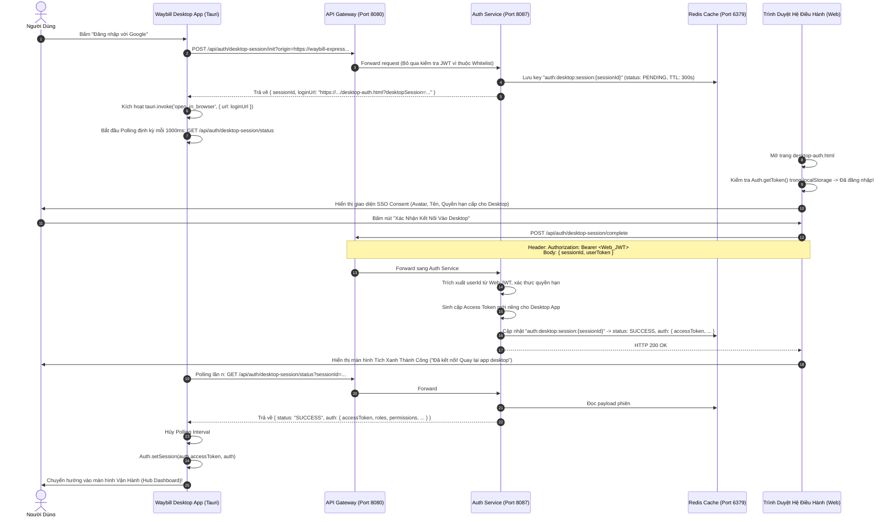
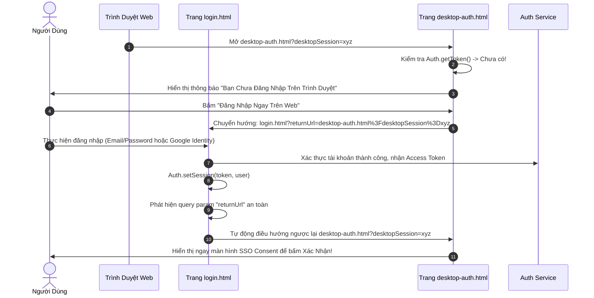

# Cẩm Nang Kỹ Thuật 26: Kiến Trúc Ứng Dụng Desktop Tauri v2 & Xác Thực SSO Consent Bàn Giao Phiên

> **Mục tiêu cẩm nang:** Hướng dẫn toàn diện kiến trúc ứng dụng máy tính đa nền tảng **Tauri v2 (Rust + Vue 3 SPA)**, cơ chế xác thực **Desktop SSO Consent** (bàn giao phiên tương tự Discord / GitHub / Slack OAuth), kỹ thuật khắc phục triệt để lỗi **403 Forbidden** và sự cố **Origin cô lập môi trường (Local Dev vs Cloud Production)**, kèm **sơ đồ tuần tự Mermaid trực quan**, **bộ mã nguồn hoàn chỉnh** và **kịch bản cURL kiểm thử thực chiến**.

---

## 1. Bản Chất Ứng Dụng Desktop & Thách Thức Xác Thực

### 1.1. Kiến Trúc Ứng Dụng Desktop Với Tauri v2
Trong dự án **Mini Waybill Platform**, ứng dụng dành cho máy tính (Desktop App) phục vụ các điều phối viên bưu cục (Hub Operators), nhân viên kho và quản trị viên vận hành tải nặng:
* **Tauri v2 Core (Rust):** Đảm nhiệm vòng đời native app, tương tác hệ điều hành, bảo mật bộ nhớ, tự động cập nhật (Auto-updater), và tiêu thụ RAM cực thấp (< 30MB RAM, file cài đặt < 15MB so với Electron > 150MB).
* **Frontend Webview (Vue 3 + Tailwind CSS):** Tái sử dụng 100% giao diện điều hành vận đơn, bản đồ GIS bưu chính, biểu đồ KPI và hệ thống âm thanh thông báo WebSocket.

```
+-------------------------------------------------------------+
|                 Waybill Platform Desktop                     |
|  +-------------------------------------------------------+  |
|  |             Vue 3 SPA (HTML5 / JS / CSS)              |  |
|  |     (Views: Shipments, Trips, Fleet, Tracking, Chat)  |  |
|  +-------------------------------------------------------+  |
|         | Tauri IPC (invoke: open_in_browser, updater)       |
|  +-------------------------------------------------------+  |
|  |               Tauri v2 Runtime (Rust)                 |  |
|  |          Window Management / System Tray / OS         |  |
|  +-------------------------------------------------------+  |
+-------------------------------------------------------------+
                              |
               HTTPS / WSS API Requests
                              v
   [ Azure Cloud K3s Gateway / Local Nginx Reverse Proxy ]
```

---

### 1.2. Thách Thức Kỹ Thuật Khi Triển Khai Xác Thực Trên Desktop

#### Thách thức 1: Chính sách cấm Webview của Google OAuth (Disallowed User-Agent)
Google OAuth 2.0 chặn hoàn toàn mọi luồng đăng nhập diễn ra bên trong Webview nhúng của ứng dụng desktop/mobile nhằm chống tấn công Man-In-The-Middle (MITM).
$$\rightarrow$$ **Hệ quả:** Bắt buộc phải mở trình duyệt mặc định bên ngoài hệ điều hành (Chrome, Edge, Firefox) để người dùng thực hiện xác thực an toàn.

#### Thách thức 2: Xung đột môi trường điều hướng (Local Dev vs Cloud Production)
Khi chạy ở môi trường phát triển (Dev), app Desktop tải tài nguyên từ `http://localhost:3000`. Khi đóng gói bản Production (.exe), app Desktop chạy dưới scheme an toàn `tauri://localhost`.
$$\rightarrow$$ **Lỗ hổng:** Nếu cấu hình cứng URL mở trình duyệt về `localhost:3000`, người dùng tải app về máy tính thật sẽ bị lỗi `ERR_CONNECTION_REFUSED` do máy tính người dùng không có server local cổng 3000.

#### Thách thức 3: Trải nghiệm người dùng rời rạc & Lỗi 403 Forbidden
* Khi mở trình duyệt ra trang đăng nhập thông thường (`login.html`), người dùng đã đăng nhập sẵn trên Web vẫn bị ép phải chọn lại tài khoản Google hoặc nhập lại mật khẩu.
* Nếu đường dẫn `/api/auth/desktop-session/**` không được cấu hình Whitelist tại **API Gateway** và **Spring Security (`SecurityConfig.java`)**, mọi request khởi tạo phiên từ Desktop sẽ bị chặn đứng với mã lỗi `403 Forbidden (Truy Cập Bị Từ Chối)`.

---

## 2. Kiến Trúc Giải Pháp: Cơ Chế Bàn Giao Phiên SSO Consent

Để giải quyết triệt để 3 thách thức trên, hệ thống áp dụng mô hình **SSO Consent Authorization** tương tự luồng cấp quyền của Discord, GitHub hoặc Slack:

```
[ App Desktop ] -------- 1. POST /init --------> [ Auth Service (Redis) ]
       |                                                    |
2. Mở trình duyệt ngoài                       Sinh SessionId (TTL 300s)
       |                                                    |
       v                                                    |
(Trình duyệt Web: desktop-auth.html)                        |
       |                                                    |
  [ Đã Login? ] ---(Có: Hiện Consent)---> [ Bấm 'Xác Nhận' ]
       |                                          |
       |                                 4. POST /complete
       |                                (Kèm JWT Web / IdToken)
       |                                          |
       v                                          v
(Chưa: Redirect login.html                       [ Auth Service ]
 rồi quay lại desktop-auth.html)              Lưu Tokens vào Redis
                                              Đổi trạng thái: SUCCESS
                                                          |
[ App Desktop ] <--- 5. Poll /status (Mỗi 1s) ------------+
Nhận JWT & Mở Dashboard!
```

---

## 3. Sơ Đồ Tuần Tự Chi Tiết (Sequence Diagrams)

### 3.1. Luồng Người Dùng Đã Đăng Nhập Sẵn Trên Trình Duyệt (Instant Consent Flow)



---

### 3.2. Luồng Người Dùng Chưa Đăng Nhập Trên Trình Duyệt (Redirect with returnUrl)



---

## 4. Thiết Kế Bảo Mật & Vòng Đời Phiên (Security Architecture)

### 4.1. Vòng Đời Phiên Kết Nối Trên Redis
Phiên kết nối được quản lý trạng thái tập trung trong Redis với prefix `auth:desktop:session:{sessionId}`:

| Trạng Thái | Thời Gian Sống (TTL) | Mục Đích |
| :--- | :--- | :--- |
| **`PENDING`** | **300 giây (5 phút)** | Chờ người dùng mở trình duyệt và phê duyệt kết nối. Quá 5 phút phiên tự hủy. |
| **`SUCCESS`** | **120 giây (2 phút)** | Chứa gói dữ liệu xác thực `AuthResponse`. Tồn tại ngắn hạn để Desktop pull về và hoàn tất. |
| **`EXPIRED`** | **Tức thời (Evicted)** | Phiên đã quá hạn, đã bị sử dụng hoặc bị từ chối. Ngăn chặn triệt để tấn công Replay Attack. |

```json
{
  "status": "SUCCESS",
  "expiresAt": 1729570000000,
  "authResponse": {
    "accessToken": "eyJhbGciOiJIUzI1NiIsInR5cCI6IkpXVCJ9...",
    "tokenType": "Bearer",
    "userId": 1,
    "email": "vankhanhak54@gmail.com",
    "fullName": "Nguyễn Văn Khánh",
    "roles": ["ROLE_ADMIN"],
    "permissions": ["SHIPMENT_VIEW", "SHIPMENT_EDIT", "STATION_DISPATCH"],
    "googleLinked": true
  }
}
```

### 4.2. Nguyên Tắc Cấp Phát Token Độc Lập (Token Isolation)
Khi người dùng bấm "Xác Nhận Kết Nối" trên trình duyệt:
1. Backend không bàn giao lại nguyên vẹn chuỗi Token của trình duyệt sang Desktop.
2. Backend bóc tách danh tính định danh (`userId`), xác thực tài khoản có đang hoạt động hay không.
3. Sinh một cặp mã JWT mới độc lập dành riêng cho thiết bị Desktop.
4. Điều này đảm bảo: Nếu người dùng đăng xuất trên Desktop, phiên làm việc trên trình duyệt Web vẫn không bị ảnh hưởng và ngược lại.

### 4.3. Phòng Chống Lỗ Hổng Open Redirect
Tham số `returnUrl` tại `login.html` được kiểm duyệt chặt chẽ:
```javascript
const urlParams = new URLSearchParams(window.location.search);
const returnUrl = urlParams.get('returnUrl');
// Chỉ chấp nhận đường dẫn tương đối bắt đầu bằng '/' hoặc cùng origin trình duyệt
if (returnUrl && (returnUrl.startsWith('/') || returnUrl.startsWith(window.location.origin))) {
    window.location.href = returnUrl;
    return;
}
```

---

## 5. Chi Tiết Triển Khai & Bộ Mã Nguồn Mẫu (Full Code Walkthrough)

### 5.1. Backend Service (`auth-service`)

#### DTO Cung Cấp Thông Tin Hoàn Tất Phiên
```java
package org.app.authservice.dto.request;

import jakarta.validation.constraints.NotBlank;
import lombok.AllArgsConstructor;
import lombok.Builder;
import lombok.Data;
import lombok.NoArgsConstructor;

@Data
@AllArgsConstructor
@NoArgsConstructor
@Builder
public class DesktopSessionCompleteRequest {
    @NotBlank(message = "Session ID không được để trống")
    private String sessionId;
    private String idToken;     // Dành cho luồng cũ xác thực Google trực tiếp
    private String userToken;   // Dành cho luồng SSO Consent bàn giao JWT hiện có
}
```

#### Service Xử Lý Bàn Giao Phiên (`DesktopAuthSessionServiceImpl.java`)
```java
@Override
public AuthResponse completeSession(DesktopSessionCompleteRequest request, String authHeader) throws Exception {
    String sessionId = request.getSessionId();
    SessionPayload payload = loadPayload(sessionId);

    if (payload == null || System.currentTimeMillis() > payload.getExpiresAt()) {
        evictPayload(sessionId);
        throw new IllegalArgumentException("Phiên đăng nhập Desktop đã hết hạn hoặc không tồn tại.");
    }

    if (!"PENDING".equals(payload.getStatus())) {
        throw new IllegalStateException("Phiên đăng nhập này đã được hoàn tất trước đó.");
    }

    User user;
    String tokenToVerify = null;

    // Ưu tiên đọc token từ Authorization Header hoặc từ Request Body
    if (authHeader != null && authHeader.startsWith("Bearer ")) {
        tokenToVerify = authHeader.substring(7).trim();
    } else if (request.getUserToken() != null && !request.getUserToken().isBlank()) {
        tokenToVerify = request.getUserToken().trim();
    }

    if (tokenToVerify != null && !tokenToVerify.isBlank()) {
        Long userId = jwtService.extractUserId(tokenToVerify);
        if (userId == null) {
            throw new IllegalArgumentException("Token người dùng không hợp lệ hoặc đã hết hạn.");
        }
        user = userRepository.findById(userId)
                .orElseThrow(() -> new IllegalArgumentException("Không tìm thấy thông tin người dùng."));
    } else if (request.getIdToken() != null && !request.getIdToken().isBlank()) {
        GoogleIdToken.Payload tokenPayload = googleVerifyService.verifyToken(request.getIdToken());
        user = authService.processGoogleUser(tokenPayload);
    } else {
        throw new IllegalArgumentException("Cần cung cấp mã xác thực tài khoản hoặc Google ID Token.");
    }

    // Sinh token mới cho ứng dụng Desktop
    String jwt = jwtService.generateToken(user);
    AuthResponse authResponse = buildAuthResponse(user, jwt);

    payload.setStatus("SUCCESS");
    payload.setAuthResponse(authResponse);
    payload.setExpiresAt(System.currentTimeMillis() + (SUCCESS_TTL_SECONDS * 1000));

    savePayload(sessionId, payload, Duration.ofSeconds(SUCCESS_TTL_SECONDS));
    return authResponse;
}
```

#### Controller Cửa Ngõ (`AuthController.java`)
```java
@PostMapping("/desktop-session/init")
public ResponseEntity<DesktopSessionInitResponse> initDesktopSession(
        @RequestParam(value = "origin", required = false) String origin) {
    return ResponseEntity.ok(desktopAuthSessionService.initSession(origin));
}

@GetMapping("/desktop-session/status")
public ResponseEntity<DesktopSessionStatusResponse> getDesktopSessionStatus(
        @RequestParam("sessionId") String sessionId) {
    return ResponseEntity.ok(desktopAuthSessionService.getSessionStatus(sessionId));
}

@PostMapping("/desktop-session/complete")
public ResponseEntity<AuthResponse> completeDesktopSession(
        @Valid @RequestBody DesktopSessionCompleteRequest request,
        @RequestHeader(value = "Authorization", required = false) String authHeader) throws Exception {
    return ResponseEntity.ok(desktopAuthSessionService.completeSession(request, authHeader));
}
```

---

### 5.2. Whitelist Đường Dẫn Tại API Gateway & Spring Security
Để Desktop App và Trình duyệt có thể gọi các API phiên mà không bị chặn lỗi 403 Forbidden:

#### Trong `SecurityConfig.java` của `auth-service`:
```java
.authorizeHttpRequests(auth -> auth
    .requestMatchers(
        "/api/auth/login",
        "/api/auth/register",
        "/api/auth/google",
        "/api/auth/desktop-session/**" // Cho phép truy cập công khai
    ).permitAll()
    .anyRequest().authenticated()
)
```

#### Trong `k8s/02-services/api-gateway.yaml`:
Đảm bảo Route định tuyến đưa `/api/auth/**` trực tiếp vào `auth-service:8087` mà không yêu cầu Bearer token trước.

---

### 5.3. Trang Cấp Quyền Độc Lập (`frontend/desktop-auth.html`)
Trang được thiết kế hoàn toàn độc lập với hiệu ứng đồ họa cao cấp:
* **Connection Bridge (Cầu nối phiên):** Tia sáng chuyển động giữa Web Avatar và App Desktop icon.
* **Avatar Radar Pulse:** Vòng nhịp xung điện thể hiện tài khoản đang hoạt động.
* **Button Shimmer:** Quét ánh sáng qua nút Xác nhận.
* **Tích xanh thành công:** SVG tự vẽ nét kèm vòng lan tỏa sóng `ripple`.

```html
<!-- Trích đoạn logic JavaScript chính trong desktop-auth.html -->
<script src="js/auth.js"></script>
<script src="js/api.js"></script>
<script>
  let activeSessionId = null;

  function initDesktopAuthPage() {
    const urlParams = new URLSearchParams(window.location.search);
    activeSessionId = urlParams.get('desktopSession');

    if (!activeSessionId) {
      switchState('expired');
      return;
    }

    const token = Auth.getToken();
    const user = Auth.getUser();

    // Nếu chưa đăng nhập -> Hiển thị màn hình yêu cầu login
    if (!token || !user) {
      switchState('unauthenticated');
      return;
    }

    // Hiển thị thông tin người dùng lên Consent Box
    document.getElementById('user-fullname').innerText = user.fullName || user.email;
    document.getElementById('user-email').innerText = user.email;
    document.getElementById('user-role').innerText = user.roles?.[0] || 'STAFF';
    document.getElementById('session-display').innerText = 
      activeSessionId.substring(0, 8) + '...' + activeSessionId.substring(activeSessionId.length - 8);

    switchState('consent');
  }

  async function handleApproveConnection() {
    const token = Auth.getToken();
    const res = await Api.post('/api/auth/desktop-session/complete', {
      sessionId: activeSessionId,
      userToken: token
    }, {
      'Authorization': `Bearer ${token}`
    });

    if (res.ok) {
      switchState('success');
    } else {
      switchState('expired');
    }
  }

  function redirectToLogin() {
    const returnUrl = encodeURIComponent(window.location.href);
    window.location.href = `login.html?returnUrl=${returnUrl}`;
  }

  document.addEventListener('DOMContentLoaded', initDesktopAuthPage);
</script>
```

---

### 5.4. Kích Hoạt Và Polling Từ Desktop App (`LoginView.js`)
```javascript
async function handleDesktopGoogleLogin() {
    clearAlert();
    googleLoading.value = true;
    try {
        const fallbackOrigin = (typeof API_BASE_URL !== 'undefined' && API_BASE_URL.startsWith('http'))
            ? API_BASE_URL
            : 'https://waybill-express.japaneast.cloudapp.azure.com';
        const originParam = window.location.origin && !window.location.origin.includes('tauri')
            ? window.location.origin
            : fallbackOrigin;

        // 1. Khởi tạo phiên
        const res = await Api.post(
            `/api/auth/desktop-session/init?origin=${encodeURIComponent(originParam)}`,
            {}, {}, { skip403Toast: true }
        );
        const data = await res.json();
        desktopSessionId.value = data.sessionId;
        const targetUrl = data.loginUrl || `${originParam}/desktop-auth.html?desktopSession=${data.sessionId}`;

        // 2. Mở trình duyệt ngoài
        if (window.__TAURI__?.core?.invoke) {
            await window.__TAURI__.core.invoke('open_in_browser', { url: targetUrl });
        } else {
            window.open(targetUrl, '_blank');
        }

        // 3. Polling kiểm tra trạng thái
        isPollingDesktopSession.value = true;
        startDesktopPolling(data.sessionId);
    } catch (err) {
        googleLoading.value = false;
        showAlert(err.message || 'Lỗi khi mở trình duyệt đăng nhập.');
    }
}
```

---

## 6. Bộ Lệnh cURL Thực Chiến & Kịch Bản Kiểm Thử Độc Lập

Bạn có thể kiểm tra toàn bộ luồng SSO Consent từ Terminal / Postman mà không cần mở giao diện app:

### Bước 1: Khởi Tạo Phiên Desktop Mới
```bash
curl -X POST "https://waybill-express.japaneast.cloudapp.azure.com/api/auth/desktop-session/init?origin=https://waybill-express.japaneast.cloudapp.azure.com" \
     -H "Content-Type: application/json"
```
**Response mẫu:**
```json
{
  "sessionId": "b90d81f9-9ff9-497d-a19f-149d3545ef3d",
  "loginUrl": "https://waybill-express.japaneast.cloudapp.azure.com/desktop-auth.html?desktopSession=b90d81f9-9ff9-497d-a19f-149d3545ef3d",
  "expiresInSeconds": 300
}
```

---

### Bước 2: Kiểm Tra Trạng Thái Ban Đầu (Phải là PENDING)
```bash
curl -X GET "https://waybill-express.japaneast.cloudapp.azure.com/api/auth/desktop-session/status?sessionId=b90d81f9-9ff9-497d-a19f-149d3545ef3d"
```
**Response mẫu:**
```json
{
  "status": "PENDING",
  "auth": null
}
```

---

### Bước 3: Giả Lập Web Cấp Quyền Bằng Token Hiện Có
```bash
curl -X POST "https://waybill-express.japaneast.cloudapp.azure.com/api/auth/desktop-session/complete" \
     -H "Content-Type: application/json" \
     -H "Authorization: Bearer <TOKEN_JWT_CUA_NGUOI_DUNG>" \
     -d '{
       "sessionId": "b90d81f9-9ff9-497d-a19f-149d3545ef3d"
     }'
```
**Response mẫu:**
```json
{
  "accessToken": "eyJhbGciOiJIUzI1NiIsInR5cCI6IkpXVCJ9...",
  "tokenType": "Bearer",
  "userId": 1,
  "email": "vankhanhak54@gmail.com",
  "fullName": "Nguyễn Văn Khánh",
  "roles": ["ROLE_ADMIN"],
  "permissions": ["SHIPMENT_VIEW", "SHIPMENT_EDIT"]
}
```

---

### Bước 4: Desktop App Polling Lại (Phải Nhận status: SUCCESS)
```bash
curl -X GET "https://waybill-express.japaneast.cloudapp.azure.com/api/auth/desktop-session/status?sessionId=b90d81f9-9ff9-497d-a19f-149d3545ef3d"
```
**Response mẫu:**
```json
{
  "status": "SUCCESS",
  "auth": {
    "accessToken": "eyJhbGciOiJIUzI1NiIsInR5cCI6IkpXVCJ9...",
    "tokenType": "Bearer",
    "userId": 1,
    "email": "vankhanhak54@gmail.com",
    "fullName": "Nguyễn Văn Khánh",
    "roles": ["ROLE_ADMIN"]
  }
}
```

---

## 7. Cấu Hình Môi Trường & Triển Khai GitOps

### 7.1. Cấu Hình Linh Hoạt Đa Môi Trường
Để tránh tình trạng Cloud mở nhầm `localhost` và Local Dev bị lỗi kết nối:

* **Môi trường Local (`application.properties`):**
```properties
app.auth.desktop-fallback-origin=http://localhost:3000
app.auth.allow-localhost-origin=true
```

* **Môi trường Cloud Production (`k8s/02-services/auth-service.yaml`):**
```yaml
env:
  - name: DESKTOP_AUTH_FALLBACK_ORIGIN
    value: "https://waybill-express.japaneast.cloudapp.azure.com"
  - name: ALLOW_LOCALHOST_AUTH_ORIGIN
    value: "false"
```

---

## 8. Cẩm Nang Khắc Phục Sự Cố Thực Chiến (Troubleshooting Guide)

| Tình Huống Sự Cố | Nguyên Nhân Cốt Lõi | Cách Khắc Phục Chuẩn Xác |
| :--- | :--- | :--- |
| **Lỗi `403 Forbidden` khi Desktop bấm đăng nhập** | API Gateway hoặc Spring Security chặn đường dẫn `/desktop-session/**`. | Kiểm tra `SecurityConfig.java` đã có `.requestMatchers("/api/auth/desktop-session/**").permitAll()`. Đảm bảo Gateway route permit all `/api/auth/**`. |
| **Trình duyệt mở `localhost:3000` thay vì Cloud** | Biến `ALLOW_LOCALHOST_AUTH_ORIGIN` trên Cloud đang là `true`, hoặc client truyền origin rỗng. | Đặt `ALLOW_LOCALHOST_AUTH_ORIGIN=false` trên k8s deployment của `auth-service` và gán fallback origin về domain Azure. |
| **Báo "Phiên kết nối đã hết hạn" ngay khi mở tab** | Quá thời gian 300 giây (5 phút), hoặc mã phiên bị truyền sai format / khoảng trắng. | Kiểm tra đồng hồ hệ thống NTP giữa các node K8s và máy khách. Bấm lại nút Đăng nhập trên Desktop để sinh session ID mới. |
| **Trình duyệt chặn đóng tab tự động (`window.close`)** | Chính sách bảo mật của các trình duyệt hiện đại (Chrome/Edge) chỉ cho phép đóng tab bằng script nếu tab đó do script `window.open` sinh ra. | Trang `desktop-auth.html` đã cài sẵn fallback: Nếu trình duyệt chặn, tự động hiện toast nhắc nhở thân thiện *"Bạn có thể đóng tab này theo cách thủ công và quay lại app Desktop!"*. |

---

## 9. Tổng Kết Giá Trị Kỹ Thuật

Cơ chế **Desktop SSO Consent** mang lại bước nhảy vọt về chất lượng hoàn thiện của hệ thống:
1. **Tuân thủ Zero-Trust & Google OAuth Policy:** Không vi phạm bảo mật Webview, đảm bảo an toàn danh tính tuyệt đối.
2. **Trải nghiệm người dùng chuẩn Enterprise:** Cung cấp giao diện cấp quyền tương tự Discord/GitHub, không bắt đăng nhập lặp lại vô lý.
3. **Cô lập môi trường triệt để:** Hoạt động liền mạch cả khi lập trình viên chạy local bằng `localhost:3000` lẫn khi nhân viên bưu chính chạy bản `.exe` cài đặt kết nối Cloud Azure.
4. **Hiệu năng siêu tốc:** Cơ chế Cache PENDING/SUCCESS trên Redis cho thời gian phản hồi kiểm tra phiên `< 1ms`.
