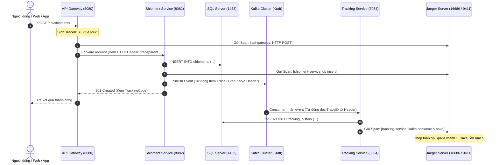

# Cẩm Nang Kỹ Thuật 27: Triển Khai Distributed Tracing Toàn Trình Với Micrometer Tracing & Jaeger

> **Mục tiêu cẩm nang:** Hướng dẫn chi tiết kiến trúc, cách cấu hình, kịch bản kiểm thử và xác thực (verification) hệ thống giám sát phân tán (**Distributed Tracing**) trên nền tảng Spring Boot 3.x/4.x, Spring Cloud Gateway WebMVC, Apache Kafka và Jaeger Tracing. Tài liệu này cung cấp đầy đủ các bước thực hành để bạn tự kiểm chứng và tự tin trả lời phỏng vấn kỹ thuật.

---

## 1. Tại Sao Cần Distributed Tracing Trong Microservices?

Trong kiến trúc Monolith, một request từ client chỉ chạy trong 1 tiến trình máy chủ (1 process), việc theo dõi lỗi hay đo đạc thời gian chỉ cần xem log của ứng dụng đó.

Tuy nhiên, trong hệ thống **Mini-Waybill-Platform**:
1. Một thao tác **"Tạo bưu gửi & tra cứu hành trình"** sẽ đi qua một chuỗi các trạm:
   $$\text{Client} \longrightarrow \text{API Gateway} \longrightarrow \text{Shipment Service} \longrightarrow \text{Kafka Topic} \longrightarrow \text{Tracking Service} \longrightarrow \text{SQL Server}$$
2. **Vấn đề nảy sinh:**
   - Nếu client bị chậm mất $2.5\text{s}$, làm sao biết thời gian bị nghẽn ở đâu (ở Gateway lọc quyền, ở Shipment ghi CSDL, hay do Kafka consumer bị delay)?
   - Nếu phát sinh lỗi 500, log của Gateway, Shipment và Tracking nằm rời rạc ở 3-4 container khác nhau, làm sao ráp nối thành 1 chu trình duy nhất?
3. **Giải pháp Distributed Tracing:**
   - Gắn cho mỗi request 1 mã định danh toàn cục: **`TraceID`** (duy nhất xuyên suốt tất cả các microservices).
   - Mỗi chặng xử lý nhỏ bên trong một service được gọi là một **`Span`** (có `SpanID`, thời gian bắt đầu, thời gian kết thúc, tags, metadata).
   - Toàn bộ Spans được gửi về **Jaeger Server** để hiển thị thành biểu đồ thời gian dạng thác nước (**Waterfall Trace Chart**).



---

## 2. Chi Tiết Thành Phần Kỹ Thuật Đã Cấu Hình

### 2.1. Thư viện trong `pom.xml` (Maven Parent)
Spring Boot 3/4 sử dụng engine **Micrometer Tracing** (thay thế cho Spring Cloud Sleuth ở Spring Boot 2 cũ). Hai thư viện cốt lõi được cấu hình tại root `pom.xml`:
* **`io.micrometer:micrometer-tracing-bridge-brave`**: Cầu nối giữa giao diện Micrometer Observation API và thư viện Brave (Zipkin standard).
* **`io.zipkin.reporter2:zipkin-reporter-brave`**: Thư viện chạy ngầm gom các Spans và gửi bất đồng bộ về Jaeger qua chuẩn Zipkin v2 JSON format.

### 2.2. Tham số trong `application.properties`
Đã cấu hình trên 4 services: `api-gateway`, `auth-service`, `shipment-service`, `tracking-service`:
```properties
# 1. Tỷ lệ lấy mẫu (Sampling Rate): 1.0 = 100% request đều được trace (rất phù hợp cho Dev/Staging/Demo)
management.tracing.sampling.probability=1.0

# 2. Endpoint Jaeger Collector (tự động nhận biến môi trường nếu chạy trong Docker)
management.zipkin.tracing.endpoint=${MANAGEMENT_ZIPKIN_TRACING_ENDPOINT:http://localhost:9411/api/v2/spans}

# 3. Mẫu Log console hiển thị: [Tên Service, TraceID, SpanID]
logging.pattern.level=%5p [${spring.application.name:},%X{traceId:-},%X{spanId:-}]

# 4. Cơ chế lan truyền Trace qua Apache Kafka (áp dụng cho shipment-service & tracking-service)
spring.kafka.template.observation-enabled=true
spring.kafka.listener.observation-enabled=true
```

### 2.3. Dịch vụ Jaeger trong `docker-compose.yaml`
```yaml
  jaeger:
    image: jaegertracing/all-in-one:latest
    container_name: waybill-jaeger
    ports:
      - "127.0.0.1:16686:16686" # Web UI trực quan
      - "127.0.0.1:9411:9411"   # Zipkin HTTP endpoint tiếp nhận Spans
      - "127.0.0.1:4317:4317"   # OpenTelemetry Protocol (OTLP) gRPC
      - "127.0.0.1:4318:4318"   # OpenTelemetry Protocol (OTLP) HTTP
    environment:
      - COLLECTOR_ZIPKIN_HOST_PORT=:9411
    restart: always
```

---

## 3. Hướng Dẫn Tự Kiểm Tra & Xác Thực (Verification Guide)

Bạn có thể tự tay kiểm chứng tính năng này hoạt động $100\%$ theo các bước thực hành dưới đây:

### Bước 1: Khởi động container Jaeger
Nếu bạn đang dùng Docker, chỉ cần chạy lệnh khởi động riêng Jaeger:
```bash
docker compose up -d jaeger
```
Kiểm tra giao diện Web của Jaeger bằng cách mở trình duyệt truy cập:
👉 **`http://localhost:16686`**

---

### Bước 2: Kiểm tra định dạng Log Console
Khi bạn khởi chạy bất kỳ microservice nào (ví dụ `api-gateway` hoặc `auth-service`), quan sát cửa sổ dòng lệnh Terminal. Mỗi log in ra sẽ có cấu trúc:
```text
 INFO [api-gateway,66f123456789abcd66f123456789abcd,66f123456789abcd] 1234 --- o.a.a.filter... : Processing request
```
* `api-gateway`: Tên service phát sinh log.
* `66f123456789abcd66f123456789abcd`: **TraceID toàn cục** (32 ký tự hex).
* `66f123456789abcd`: **SpanID hiện tại**.

> **Mẹo:** Khi debug lỗi trên production, bạn chỉ cần copy `TraceID` này rồi dán vào ô tìm kiếm của Jaeger UI hoặc Kibana/Grafana là ra toàn bộ chuỗi hành trình từ đầu đến cuối!

---

### Bước 3: Gửi request kiểm thử qua API Gateway
Thực hiện một request tra cứu hoặc tạo đơn (ví dụ qua cURL hoặc Postman):
```bash
# Ví dụ 1: Gọi endpoint Actuator qua API Gateway
curl -X GET http://localhost:8080/actuator/health

# Ví dụ 2: Tra cứu vết vận đơn công khai
curl -X GET http://localhost:8080/api/tracking/public/WB123456789VN
```

---

### Bước 4: Xem biểu đồ Waterfall trên Jaeger UI
1. Truy cập lại **`http://localhost:16686`**.
2. Ở menu bên trái:
   - **Service**: Chọn `api-gateway` (hoặc `shipment-service`).
   - Nhấn nút **Find Traces**.
3. Bạn sẽ thấy danh sách các Trace gần nhất. Bấm vào một Trace để xem chi tiết:
   - Biểu đồ hình thác nước (**Waterfall**) hiện ra trực quan.
   - Bạn sẽ nhìn thấy rõ ràng từng microservice phản hồi trong bao nhiêu mili-giây:
     - `api-gateway`: 25ms
     - `tracking-service`: 18ms
     - `sql-query`: 2ms

---

## 4. Những Câu Hỏi Phỏng Vấn "Ăn Điểm" Về Distributed Tracing

### ❓ Câu 1: "Trace Context được truyền qua lại giữa các Microservices như thế nào?"
* **Trả lời:**
  * **Qua giao thức HTTP:** Micrometer/Brave sử dụng chuẩn **W3C TraceContext** để tự động gắn thêm header `traceparent` (chứa Version, TraceID, ParentSpanID, TraceFlags) vào outgoing HTTP request khi dùng `RestClient`, `WebClient` hoặc qua Gateway. Service nhận sẽ đọc header này để tái lập Trace Context mà không sinh TraceID mới.
  * **Qua Apache Kafka:** Nhờ bật `spring.kafka.template.observation-enabled=true`, Spring Kafka tự động nhúng TraceID dưới dạng byte array vào **Record Headers** của message. Phía Consumer (`spring.kafka.listener.observation-enabled=true`) sẽ đọc header này và tiếp tục nối dài Span hiện tại.

---

### ❓ Câu 2: "Tại sao trên Production người ta KHÔNG BAO GIỜ đặt `sampling.probability=1.0`?"
* **Trả lời:**
  * Nếu hệ thống có $100.000$ RPS, đặt sampling $1.0$ ($100\%$) sẽ sinh ra $100.000$ traces/giây. Việc này gây:
    1. Tiêu tốn băng thông mạng nội bộ đáng kể chỉ để gửi telemetry data.
    2. Gây quá tải bộ nhớ và ổ đĩa của cụm Jaeger/Elasticsearch.
    3. Giảm Throughput của chính các microservices.
  * **Thực tế Production:** Thường đặt sampling ở mức $0.05$ đến $0.1$ ($5\% - 10\%$), hoặc sử dụng **Tail-based Sampling** (chỉ giữ lại những request bị lỗi 5xx hoặc request có độ trễ cao vượt ngưỡng p99).

---

### ❓ Câu 3: "Sự khác biệt giữa Spring Cloud Sleuth và Micrometer Tracing trong Spring Boot 3 là gì?"
* **Trả lời:**
  * Kể từ Spring Boot 3.0, dự án Spring Cloud Sleuth đã bị khai tử và sáp nhập vào dự án **Micrometer Tracing**.
  * Micrometer Tracing đóng vai trò là tầng trừu tượng (Façade/Interface), cho phép lập trình viên linh hoạt hoán đổi Tracer engine bên dưới giữa **Brave** (hệ sinh thái Zipkin) hoặc **OpenTelemetry (OTel)** mà không phải sửa lại một dòng code Java nào.
